# Pixel Hatch

**English** · [Русский](README.ru.md)

A pocket-sized pixel workshop for BUSY Bar. Press **Start** and one pixel falls into the silhouette. When the last pixel lands, the shape comes to life.


Built for the [BUSY JS Apps Contest](https://busy.app/pages/js-apps-contest).

## How it works

The **72 × 16 front display** shows a silhouette. Each tap drops one pixel from the top edge. Pixels settle from the bottom up, and fast taps queue up so several pixels can fall at once. Hold **Start** to drop a single pixel.

The **160 × 80 rear display** shows the selected shape, landed pixels, and the number needed to finish. Each shape remembers its progress while the app is open.

| Control | Action |
| --- | --- |
| **Start / Pause** | Drop one pixel. |
| **Turn the wheel** | Choose a shape. |
| **OK** | Empty the selected shape and start over. |
| **Back** | Exit the app. |

## Shape gallery

All frames were captured in the official BUSY Bar Emulator.

| Shape | Empty | After filling |
| --- | :---: | :---: |
| **Heart**<br>Beats in time with the pulse traces. | 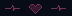 | 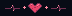 |
| **Piggy Bank**<br>Gallops from side to side. | 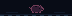 | 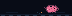 |
| **Popcorn**<br>Kernels burst out of the bucket and scatter across the display. | 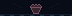 | 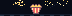 |
| **Spaceship**<br>Lifts off in a plume and leaves a crater. |  |  |
| **Car**<br>Fills up at the pump, then drives across the display. |  | 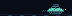 |
| **Ghost**<br>Glides across the screen with glowing eyes. |  |  |
| **Jellyfish**<br>Swims with waving tentacles and a trail of bubbles. |  |  |
| **Flower**<br>Opens a ring of bright petals. | 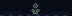 | 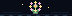 |

| One pixel falling | A halfway-filled heart | Rear dashboard | Crater after launch |
| :---: | :---: | :---: | :---: |
| 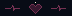 | 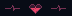 | 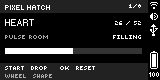 |  |

## Build and run

Use Node.js **22.12 or later** and start the [official BUSY Bar Emulator](https://github.com/busy-app/busybar-emulator).

```sh
npm ci
npm test
npm run build
npm run app:install -- --addr 127.0.0.1:8640
npm run app:run -- --addr 127.0.0.1:8640
```

The build produces `dist/io.github.realzel.pixelhatch.tgz`. You can also upload this package through your BUSY Bar's web interface. Both displays and controls are available on the [emulator page](http://127.0.0.1:8640/emulator).

Pixel Hatch runs offline on BUSY Bar. Progress is kept in memory for the current session.
