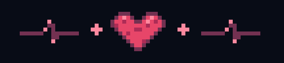
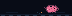
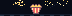
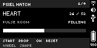

# Pixel Hatch

[English](README.md) · **Русский**

Пиксельная мастерская для BUSY Bar. Нажми **Start**, и в силуэт упадёт один пиксель. Когда последний пиксель займёт своё место, фигура оживёт.



Проект создан для хакатона [BUSY JS Apps Contest](https://busy.app/pages/js-apps-contest).

## Как это работает

Передний экран **72 × 16** показывает силуэт. При каждом нажатии один пиксель падает с верхнего края и заполняет фигуру снизу вверх. При быстрых нажатиях пиксели встают в очередь и могут лететь одновременно. Удержание **Start** добавляет один пиксель.

На заднем экране **160 × 80** видны название фигуры, число приземлившихся пикселей и сколько нужно для заполнения. Прогресс каждой фигуры сохраняется, пока приложение открыто.

| Управление | Действие |
| --- | --- |
| **Start / Pause** | Уронить один пиксель. |
| **Поворот колёсика** | Выбрать фигуру. |
| **OK** | Очистить выбранную фигуру и начать заново. |
| **Back** | Выйти из приложения. |

## Галерея фигур

Все кадры сняты в официальном эмуляторе BUSY Bar.

| Фигура | Пустая | После заполнения |
| --- | :---: | :---: |
| **Сердце**<br>Бьётся в такт линиям пульса. |  |  |
| **Свинья-копилка**<br>Галопом бегает по экрану. |  |  |
| **Попкорн**<br>Вылетает из корзины и разлетается по экрану. |  |  |
| **Космический корабль**<br>Взлетает, оставляя дым и кратер. |  |  |
| **Машина**<br>Заправляется у колонки, затем едет по экрану. |  |  |
| **Призрак**<br>Плывёт по экрану со светящимися глазами. |  |  |
| **Медуза**<br>Плывёт, шевелит щупальцами и оставляет след из пузырьков. |  |  |
| **Цветок**<br>Раскрывает кольцо ярких лепестков. |  |  |

| Падающий пиксель | Наполовину заполненное сердце | Задний экран | Кратер после взлёта |
| :---: | :---: | :---: | :---: |
|  |  |  |  |

## Сборка и запуск

Установи Node.js **22.12 или новее** и запусти [официальный эмулятор BUSY Bar](https://github.com/busy-app/busybar-emulator).

```sh
npm ci
npm test
npm run build
npm run app:install -- --addr 127.0.0.1:8640
npm run app:run -- --addr 127.0.0.1:8640
```

После сборки в `dist/` появится пакет `io.github.realzel.pixelhatch.tgz`. Его можно загрузить через веб-интерфейс устройства. Оба экрана и кнопки доступны на [странице эмулятора](http://127.0.0.1:8640/emulator).

Pixel Hatch работает офлайн. Прогресс хранится в памяти в пределах текущего сеанса.
